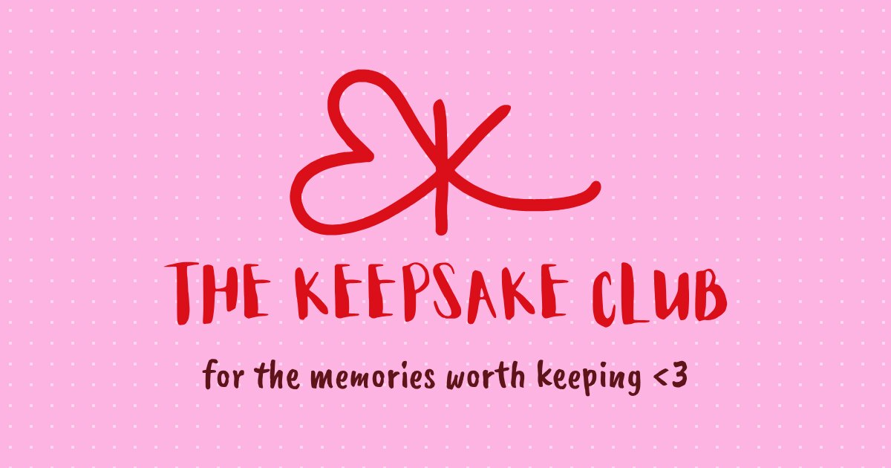

<div align="center">

# The Keepsake Club

**A hand-drawn, scrapbook-style landing page for an Egypt-based gift shop that sells through Instagram.**

[**Live site →**](https://the-keep-sake-club.vercel.app)




</div>

---

## About the project

[The Keepsake Club](https://www.instagram.com/thekeepsakeclubb/) sells personalized gift bundles and
custom keepsake books, and takes every order through Instagram DMs. Before this site, the shop's only
home was its Instagram grid, which made it hard for new customers to see the whole range, read the policy
or understand how ordering works.

This site gives the shop a proper storefront **without adding a cart or a checkout**. It
fits the way the shop already works. Every "order via dm" button copies a pre-written message about that
exact gift to the clipboard, shows a toast, and opens the shop's Instagram DM. The customer only has to
paste and send.

The visual direction is a **"gift-wrapped scrapbook"**: bubblegum pink, ribbon red, washi tape,
hand-drawn doodles and a traced version of the brand's own monogram, all taken from the shop's Instagram.

## Highlights

### Interactive features

- **Filterable collection with flip cards.** Category filter chips use animated layout transitions.
  Each product card flips in 3D to show a "take a closer look.." view: on hover with a mouse, or with a
  button on touch screens.
- **Product spotlight with hotspots.** Numbered, keyboard-accessible hotspots on the product photos
  explain what's inside each basket.
- **Live card builder.** Customers type a recipient, a message and a sender, then pick a paper color.
  A live preview of the card updates as they type, and the finished order text is copied straight into the DM.
- **Page-turn "peek inside"** for the keepsake books, done with 3D CSS transforms.
- **Self-drawing SVG doodles** (ribbons, arrows, hearts) that draw themselves in as you scroll.
- **Optional WhatsApp ordering.** Setting a phone number in one config file gives every order button
  a WhatsApp partner button with the same pre-filled message.

### Performance

- **Pre-rendered at build time.** A custom SSR step (`entry-server.tsx` + `scripts/prerender.mjs`)
  bakes the full page into `index.html`, so text, images and links appear before any JavaScript runs.
- **Deferred hydration.** `boot.ts` waits for the first paint's resources and then loads React during
  browser idle time (`requestIdleCallback`). This keeps slow mobile connections free for what's on screen.
  Because every order button is a real `<a>` link, the page works before hydration, and even with
  JavaScript turned off.
- **No layout shift from fonts.** Six fonts are self-hosted, the above-the-fold ones are preloaded, and
  `size-adjust` fallback fonts match the real fonts' metrics, so text doesn't jump when they load.
- **`content-visibility: auto`** on off-screen sections, plus a custom anchor-scroll handler that
  renders those sections fully before an in-page jump, so nav links land in exactly the right place.
- **Resilient images.** A shared `` component lazy-loads images, shows a branded loading state,
  and falls back to a tinted, labelled placeholder if a file is missing.

### Accessibility

- A skip link, landmarks and labelled sections throughout.
- The mobile menu traps focus, closes on Escape, locks page scroll and returns focus to the button
  that opened it.
- Toggle controls use `aria-pressed`, the product spotlight uses tab semantics, and screen-reader-only
  labels give icon buttons and repeated "order" links context.
- Every animation respects `prefers-reduced-motion` (through Framer Motion's `MotionConfig` and CSS).

### SEO and link sharing

- A small custom **Vite plugin** fills in the site URL at build time. It reads `SITE_URL`, or falls
  back to Vercel's production domain. With that URL it writes the canonical and Open Graph tags and
  generates `robots.txt` and `sitemap.xml`, so link previews on WhatsApp, Instagram and iMessage always
  point at a real address.

## Tech stack

| Area      | Tools                                                      |
| --------- | ---------------------------------------------------------- |
| Framework | React 19 (with `hydrateRoot` / `renderToString` for pre-rendering) |
| Language  | TypeScript 6 (strict, type-checked as part of the build)   |
| Styling   | Tailwind CSS 4 with a custom `keepsake` design-token theme |
| Animation | Framer Motion                                              |
| Icons     | lucide-react + hand-made inline SVG doodles                |
| Tooling   | Vite 8, Oxlint                                             |
| Hosting   | Vercel                                                     |

## Engineering challenges I solved

**Mobile menu showed up as an empty strip after scrolling.** Once the page scrolled, the sticky header
got `backdrop-filter: blur()`. That turns the header into the containing block for any
`position: fixed` child, so the drawer shrank to the header's 72px height. I moved the drawer into
`<body>` with a React portal. The portal only renders on the client (using `useSyncExternalStore`),
so the server pre-render stays valid.

**Unstyled flash on first load.** At first the stylesheet loaded together with the deferred app bundle,
so the pre-rendered HTML briefly painted without any styles. I moved the CSS import into the entry
file so Vite links it in `<head>`.

**In-page links landing in the wrong place.** `content-visibility: auto` gives off-screen sections an
*estimated* height, so native `#anchor` jumps missed their targets. A global click handler now renders
every section for real before the first jump and then scrolls, while still respecting reduced motion
and modifier-key clicks.

**Hotspots on cropped images.** The product photos are shown with `object-fit: cover`, so the crop
depends on screen size. `coverPoint()` maps a hotspot's position on the original image to its position
inside the cropped frame, and hides hotspots that fall outside it.

## Architecture

```
src/
├── boot.ts               # Entry: links CSS, defers loading the app until the page is idle
├── main.tsx              # Hydrates the pre-rendered HTML (or renders from scratch in dev)
├── entry-server.tsx      # renderToString used by the build-time pre-render
├── App.tsx               # Page composition
├── components/
│   ├── layout/           # AnnouncementBar, Navbar (portal drawer), Footer
│   ├── sections/         # Hero, Collection, CloserLook, MakeItYours, KeepsakeBooks, FAQ…
│   ├── ui/               # Reusable building blocks: Button, DmButton, Img, Accordion, Toast, Marquee…
│   └── doodles/          # Inline SVG doodles, the traced logo and the self-drawing <Draw> path
├── data/                 # All content: products, FAQ, policy, steps, testimonials, site config
└── lib/                  # Clipboard, anchor scrolling, cover-point math, media-query hook
scripts/prerender.mjs     # Injects the rendered HTML into dist/index.html
```

All content lives in typed data files under `src/data/`, separate from the components, so the shop
owner can update products, prices, the FAQ or the policy without touching any UI code. The
[content guide](docs/CONTENT-GUIDE.md) shows the owner how.

## Running locally

```bash
git clone https://github.com/Ahmed-Assem99/TheKeepSakeClub.git
cd TheKeepSakeClub
npm install
npm run dev        # http://localhost:3000
```

| Command           | What it does                                                        |
| ----------------- | ------------------------------------------------------------------- |
| `npm run dev`     | Dev server with hot reload                                          |
| `npm run build`   | Type-check → client build → SSR build → pre-render into `dist/`     |
| `npm run preview` | Serve the production build locally                                  |
| `npm run lint`    | Lint with Oxlint                                                    |

## Author

**Ahmed El Fakharany** · [GitHub](https://github.com/Ahmed-Assem99)

Photos and brand assets belong to The Keepsake Club.
